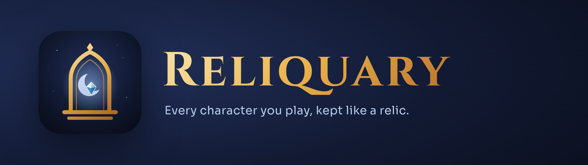
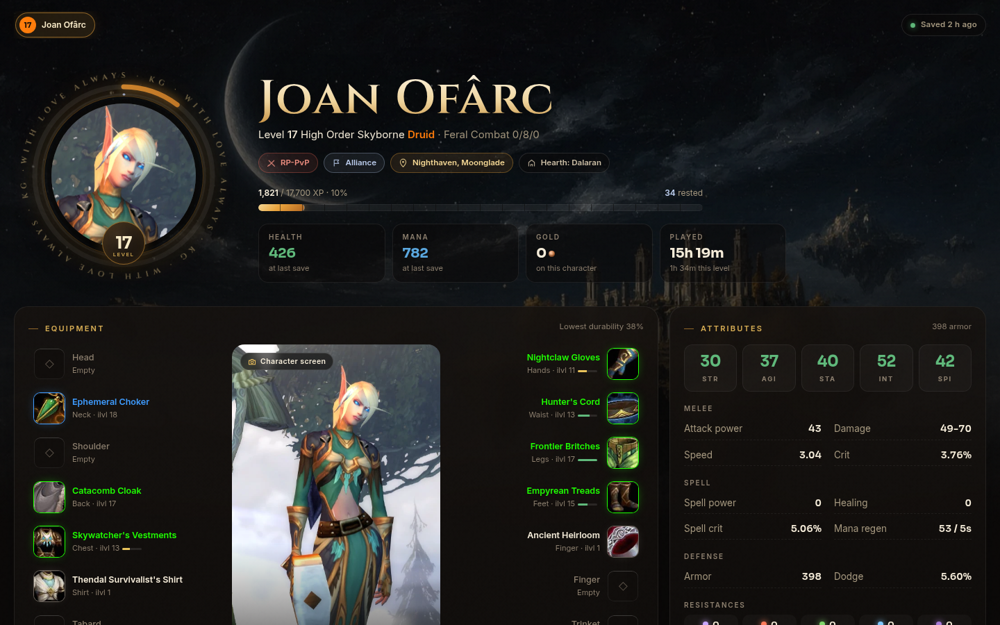

<p align="center"></p>

<p align="center">
  <a href="https://www.curseforge.com/wow/addons/reliquary-character-chronicle"><b>Get it on CurseForge</b></a>
  &nbsp;·&nbsp;
  <a href="https://reliquary.libertyhillstudio.com/">See a character's page</a>
  &nbsp;·&nbsp;
  <a href="https://libertyhillstudio.com">Liberty Hill Studios</a>
</p>

# Reliquary

Reliquary is an addon for **WoW: Forever** that keeps a record of every character you play: gear
with its tooltips, stats, talents and Legacy, bags and bank, professions with every recipe,
reputation, quests, gold, time played and a timeline of every place you've stood. It takes your
character's photo by itself the first time you stand somewhere new, at each level-up and while you
rest.

Each character can share what it chooses with its guild, its friends or anyone, and `/rq` opens a
window on what others share: your guild with its bank and chat, your friends, and the players
you've met. Every item opens a page that says who in the guild it would help most, who can make it,
whose recipes use it, what it sells for and where it comes from.

Reliquary is made by [Liberty Hill Studios](https://libertyhillstudio.com), an independent game
studio in the Texas Hill Country, building its games in the open with the testers, artists and
players who help make them. Anyone can apply to be a tester: make an account at
[libertyhillstudio.com/signup](https://libertyhillstudio.com/signup) and apply for a seat on the crew.

<p align="center"></p>

## Install

Install **Reliquary: Character Chronicle** from
[CurseForge](https://www.curseforge.com/wow/addons/reliquary-character-chronicle) with the
CurseForge app, or copy `addon/Reliquary` from this repository into
`_forever_/Interface/AddOns/` and restart the game. Then type `/rq`.

| Command | What it does |
| --- | --- |
| `/rq` | Opens the window |
| `/rq share` | Chooses who sees this character, for example `/rq share gold public off` |
| `/rq look <name>` | Asks a player for what they share |
| `/rq status` | Shows what's recorded |
| `/rq help` | Lists the rest |

## Privacy

World of Warcraft doesn't let addons connect to the internet: an addon can only talk inside the
game. Reliquary has no server and sends nothing to Liberty Hill Studios.

- What it records stays on your computer, in the file the game saves for each addon.
- Sharing is off until you turn it on, character by character, and only the parts you tick go to
  the players you chose, through the game's own addon messages. Turn a part off and those who had
  it are told to forget it.
- Guild chat, officer chat and whispers are never sent anywhere.
- It never presses a key or acts in the game. The only thing it sends is a chat line you type and
  press Enter on.

## The dashboard

Besides the addon, this repository holds a dashboard: a page that reads the addon's saved data and
shows your characters on your desktop or phone, live within a couple of seconds of each save. It
runs on your own computer and needs Python 3 (standard library only) and, for photo copies,
ImageMagick.

```sh
python3 server/reliquary.py --wtf "<WoW folder>/_forever_/WTF/Account"
```

Then open http://127.0.0.1:8741/ (add `?demo=1` to see the sample data in `data/sample`). `--public` serves a
read-only copy with nothing private on it, showing only characters that share publicly; that is
what https://reliquary.libertyhillstudio.com/ runs.

## What's here

| Folder | What it holds |
| --- | --- |
| `addon/Reliquary` | The addon. `Reliquary.lua` records, `Share.lua` shares, `Viewer*.lua` is the `/rq` window, `Skin.lua` and `Motion.lua` its look and motion |
| `server` | The dashboard server and the saved-file reader, Python standard library only |
| `web` | The dashboard page: plain HTML, CSS and JavaScript, no build step |
| `tests` | A simulated game client, a simulated world of players sharing with each other, and the server's tests |
| `tools` | The test runner, the installer, packaging, renders of the window and its art builds |
| `brand`, `docs` | The logo, the window's art sources and its design notes ([docs/DESIGN.md](docs/DESIGN.md)) |

## Building and testing

`tools/test.sh` runs everything: the addon against the simulated client in four scenarios, eight
players sharing through a simulated server, the timeline, and the server's tests. It needs Lua 5.1
(`lua5.1`, `luac5.1`), LuaJIT, Python 3 and Node.js.

`tools/install-addon.sh` copies the addon into the game (set `WOW_FOREVER` if the game isn't in
`/mnt/games/wow-forever`), and `tools/package.sh` builds the CurseForge zip.

Before calling a game function from the addon, check that it exists and isn't protected on Forever,
in Blizzard's own code for the build: the `forever` branch of
[Gethe/wow-ui-source](https://github.com/Gethe/wow-ui-source).

## Contributing

Bug reports, ideas and pull requests are welcome: see [CONTRIBUTING.md](CONTRIBUTING.md). Rather
email? Send bug reports and suggestions to
[support@libertyhillstudio.com](mailto:support@libertyhillstudio.com). The changelog is
[CHANGELOG.md](CHANGELOG.md).

## License

Reliquary is licensed under the [Apache License 2.0](LICENSE). Anyone who passes it on, changed or
not, keeps the [NOTICE](NOTICE) with it, crediting Liberty Hill Studios. The Liberty Hill Studios
and Reliquary names and logos aren't covered by the license: a changed version goes by its own name
and icon. NOTICE lists the files that draw them and the fonts' own licenses.

World of Warcraft and Warcraft are trademarks of Blizzard Entertainment, Inc. Reliquary is not
made, sponsored or endorsed by Blizzard Entertainment.

<p align="center"><br><a href="https://libertyhillstudio.com"></a><br>
<b><a href="https://libertyhillstudio.com">Liberty Hill Studios</a></b><br>
<sub>Independent games, built in the open with the crew who play them.</sub></p>
